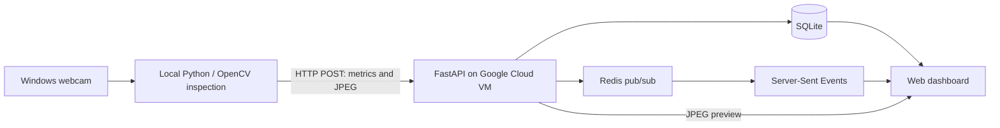

# OLED Inspection System

A prototype OLED inspection pipeline with a Windows camera client and a cloud-hosted inspection API and dashboard.

## Architecture



## Repository layout

- `local/`: Windows camera and inspection code.
- `cloud/`: Docker Compose, FastAPI service, and dashboard.
- `legacy-flask/`: Earlier Flask-based local web application, retained for reference.
- `docs/ARCHITECTURE.md`: Components and data flow.
- `docs/RUNBOOK.md`: Startup, troubleshooting, and deployment notes.

## Local camera client

On Windows, install dependencies from `local/requirements.txt`, start the SSH tunnel to the VM if using the localhost endpoint, and run `local/camera_inspection.py`. Review its configuration for the API URL and camera device before running.

## Cloud service

On the VM, the cloud service is started from the `cloud/` directory with Docker Compose. Keep the runtime database and inspection images on persistent storage outside Git.

```bash
sudo docker compose up -d --build
sudo docker compose ps
curl http://127.0.0.1:8000/api/health
```

Dashboard (through SSH tunnel): `http://localhost:8000/dashboard`.

## Security

Never commit `.env` files, private keys, passwords, tokens, SQLite databases, or inspection images. Review `cloud/compose.yaml` and Python configuration before pushing. Prefer environment variables for credentials.

## Status

This is a working development prototype, not a production-hardened inspection service. See the runbook for operational checks.
