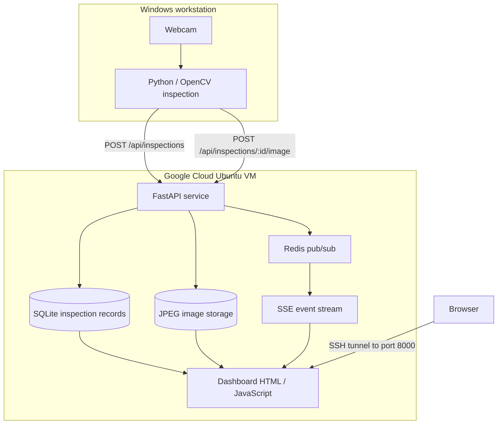

# System Architecture

## Overview

The system separates image acquisition from cloud processing and reporting.

## Responsibilities

- **Windows camera client:** Captures frames, calculates brightness/uniformity metrics and PASS/FAIL status, and submits results to the API.
- **FastAPI:** Accepts inspection records, stores metadata, serves JPEG previews, and exposes the dashboard and SSE feed.
- **SQLite:** Stores inspection history. Persist outside ephemeral containers.
- **Redis:** Distributes notifications to connected dashboard clients.
- **Dashboard:** Loads recent records and listens for new inspections through server-sent events.
- **Legacy Flask:** Historical local web interface, not the current cloud API.

## API endpoints observed in development

| Endpoint | Purpose |
|---|---|
| `GET /api/health` | Health check |
| `POST /api/inspections` | Create inspection record |
| `GET /api/inspections` | Read inspection history |
| `POST /api/inspections/{id}/image` | Upload JPEG for inspection |
| `GET /api/inspections/{id}/image` | Retrieve JPEG |
| `GET /api/events` | SSE updates |
| `GET /dashboard` | Dashboard |

## Boundaries and security

The SSH tunnel forwards a Windows local port to the VM's localhost API port. It is not a file-transfer prerequisite. SCP uses its own SSH connection. Keep service credentials out of the repository, restrict VM network exposure, and back up SQLite/image storage separately.
